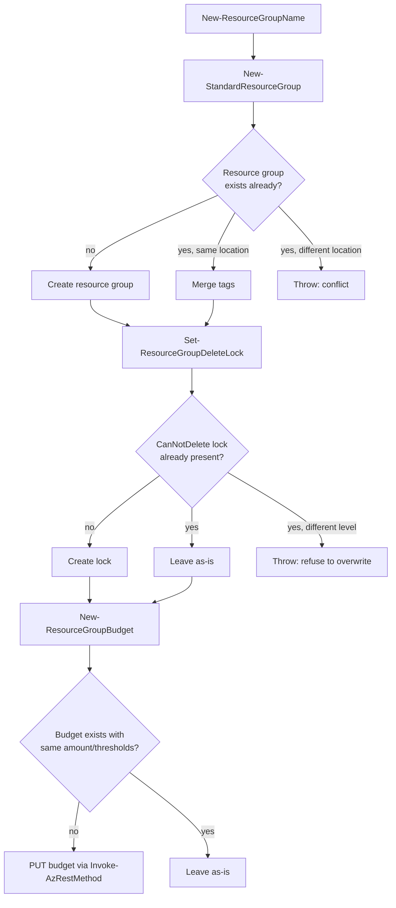

# AzResourceGroupKit

A small PowerShell module that standardizes how resource groups get created in
Azure: a fixed naming convention, a mandatory delete lock, and a monthly cost
budget with alert thresholds, all in one idempotent call.

## Problem

> Build a reusable PowerShell or Python module for Azure that automates the
> creation of Resource Groups with consistent naming, locking, and budget
> alerts.

Teams tend to create resource groups ad hoc: inconsistent names, no delete
protection, no cost visibility until the bill arrives. This module wraps the
three steps (name, create, lock, budget) behind one function so every
resource group a team creates looks the same and has the same guardrails.

## Scope

- PowerShell only, built against **PowerShell 7.2+** and the `Az.Accounts` /
  `Az.Resources` modules. Windows PowerShell 5.1 is not supported (the module
  manifest declares `PowerShellVersion = '7.2'`).
- One real cloud concept implemented per step: naming, resource group
  creation, a `CanNotDelete` management lock, and a `Microsoft.Consumption`
  budget. There is no drift-detection, no deletion of resource groups, and no
  support for policy assignments or RBAC.
- The budget is created through `Invoke-AzRestMethod` against the
  `Microsoft.Consumption/budgets` REST API directly, because neither
  `Az.Billing` nor `Az.CostManagement` exposes a clean resource-group-scoped
  budget cmdlet. This is the standard, supported way to reach an ARM API the
  Az modules don't wrap.

## Naming convention

```
<environment>-<application>-<region>-rg
```

- `environment` is one of `dev`, `test`, `stage`, `prod`.
- `application` is lowercase letters/digits/hyphens, 2-30 characters.
- `region` is a lowercase Azure region short name with no hyphens (e.g.
  `eastus`, `westeurope`).
- The literal suffix is always `-rg`.

Example: `prod-billing-eastus-rg`. `New-ResourceGroupName` builds a
conforming name from parts; `Test-ResourceGroupName` validates an arbitrary
string against the same pattern.

## Flow



`Invoke-ResourceGroupBootstrap` runs all four steps in order and returns the
resulting resource group, lock, and budget objects.

## Usage

```powershell
Import-Module ./src/AzResourceGroupKit/AzResourceGroupKit.psd1

Invoke-ResourceGroupBootstrap `
    -Environment prod -Application billing -Region eastus `
    -Location eastus `
    -SubscriptionId '00000000-0000-0000-0000-000000000000' `
    -BudgetAmount 500 -AlertThreshold 80,100 `
    -ContactEmail 'team@example.com'

# Preview changes without calling Azure
Invoke-ResourceGroupBootstrap -Environment prod -Application billing -Region eastus `
    -Location eastus -SubscriptionId '00000000-0000-0000-0000-000000000000' `
    -BudgetAmount 500 -AlertThreshold 80,100 -ContactEmail 'team@example.com' -WhatIf
```

Each step function (`New-StandardResourceGroup`, `Set-ResourceGroupDeleteLock`,
`New-ResourceGroupBudget`) can also be called on its own and supports
`-WhatIf`.

## Idempotency

- **Resource group**: if a group with the target name already exists in the
  same location, its tags are merged (not replaced) instead of calling
  `New-AzResourceGroup` again. If it exists in a *different* location this is
  treated as a conflict and the function throws, rather than silently
  continuing against the wrong resource group.
- **Lock**: the module only manages a single named lock
  (`standard-delete-lock` by default). If that lock already exists as
  `CanNotDelete`, nothing changes. If it exists with a different level, the
  function throws instead of overwriting it.
- **Budget**: the current budget is read first; if the amount and the full
  set of alert thresholds already match, no `PUT` is issued.

## Security notes

- No credentials are stored or required to run the tests — every Az cmdlet
  used by the module is mocked in Pester. Running the module for real still
  requires a normal `Connect-AzAccount` session with the Az PowerShell
  modules, same as any other Az script.
- The least-privilege Azure RBAC actions needed to run this for real:
  `Microsoft.Resources/subscriptions/resourceGroups/write`,
  `Microsoft.Authorization/locks/write`, `Microsoft.Authorization/locks/read`,
  and `Microsoft.Consumption/budgets/write` (and `/read`) scoped to the
  target resource group/subscription.
- All subscription IDs and emails in this repository are placeholders
  (`00000000-0000-0000-0000-000000000000`, `team@example.com`). No real
  tenant, subscription, or credential is referenced anywhere.

## Testing status

**This module has never been run against a real Azure subscription.** Every
test mocks the underlying `Az.Resources` / `Invoke-AzRestMethod` calls with
Pester's `Mock`; no network call, authentication, or live Azure API response
has ever been exercised. That means:

- Tested: naming-convention generation and validation (including negative
  cases), idempotency and conflict handling for the resource group, lock,
  and budget steps, `-WhatIf` making zero mocked calls at every level, and
  input validation (invalid environment, invalid threshold range).
- Not tested: actual Azure API behavior, auth/permission errors, API
  throttling, the real shape of `Invoke-AzRestMethod` responses beyond what
  this module's tests assume, and any Az module version skew.
- Linted with PSScriptAnalyzer (1.22.0); 0 findings.

Treat this as a reviewed design, not a battle-tested tool — validate against
a real (non-production) subscription before using it anywhere that matters.

## Running locally

```powershell
Install-Module Pester -RequiredVersion 5.6.1 -Scope CurrentUser
Install-Module PSScriptAnalyzer -RequiredVersion 1.22.0 -Scope CurrentUser
Install-Module Az.Accounts -RequiredVersion 2.19.0 -Scope CurrentUser
Install-Module Az.Resources -RequiredVersion 6.16.1 -Scope CurrentUser

Invoke-ScriptAnalyzer -Path ./src -Recurse -Severity Warning,Error
Invoke-Pester -Path ./tests/AzResourceGroupKit.Tests.ps1
```

Requires PowerShell 7.2+ (`pwsh`), not Windows PowerShell 5.1.
